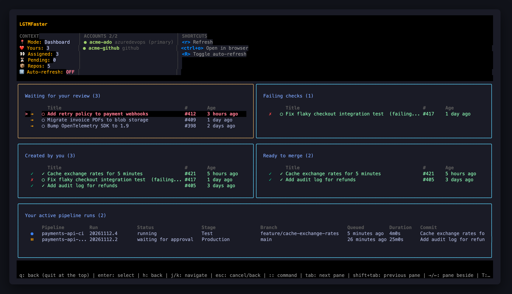
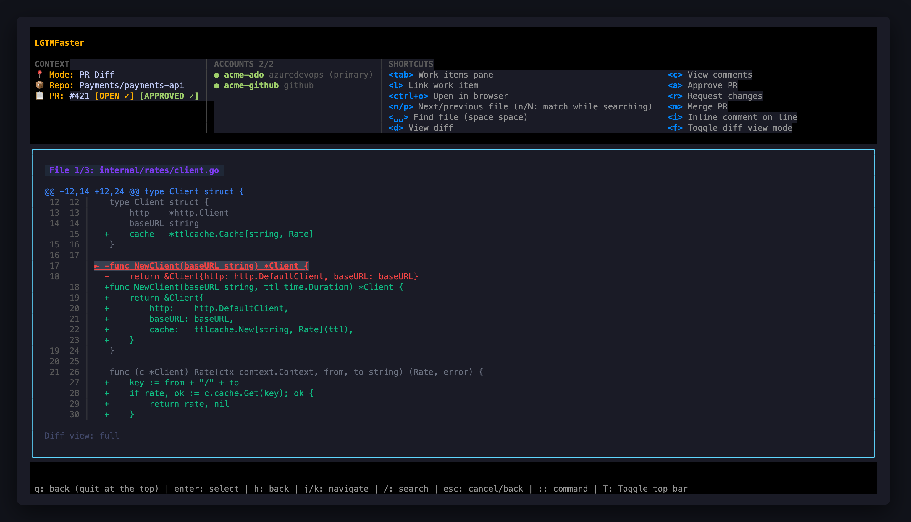
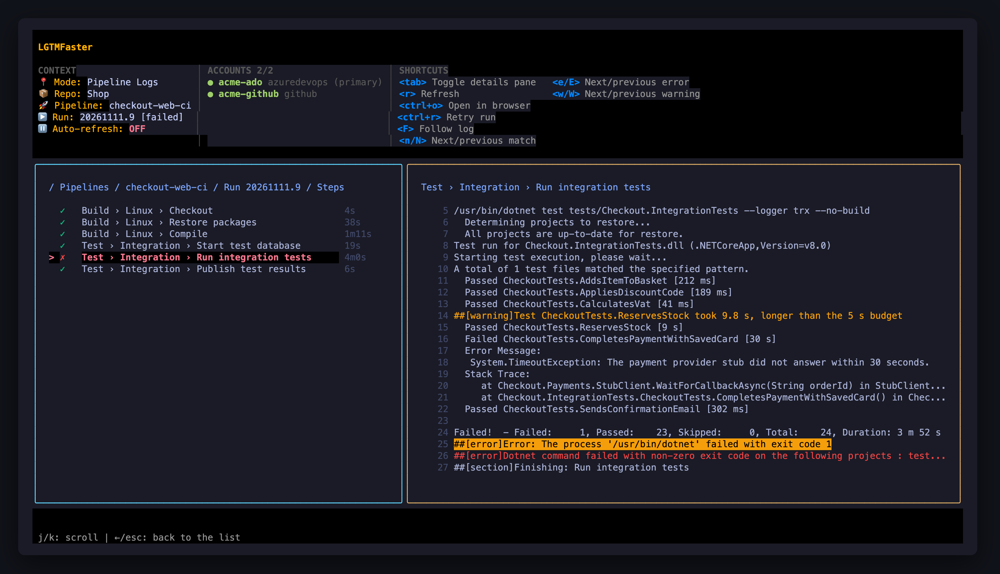

# LGTMFaster

A fast, keyboard-driven TUI for reviewing pull requests and monitoring pipelines on Azure DevOps and GitHub.

Manage PRs across multiple accounts, review diffs, leave comments, approve, merge, and work with local repositories — without leaving the terminal.



### Review pull requests

Browse diffs with vim motions, search files, comment on lines, approve, request changes, and merge. Filter whitespace changes, switch diff modes, and navigate files with fuzzy search (`<space><space>`).



### Monitor pipelines

Browse Azure DevOps pipelines across projects, track runs and stages, manage approvals, and inspect logs with search and follow mode.



## Install

```bash
brew install --cask jaforsgren/tap/lgtmfaster
```

Or build from source:

```bash
make build      # build ./lgtmfaster
make install    # install to $GOPATH/bin
```

Or build directly with Go:

```bash
go build -o lgtmfaster ./cmd/lgtmfaster
```

Run with `lgtmfaster`, or use `lgtmfaster --debug /tmp/lgtm.log` to write logs to a file.

## Getting started

1. Launch the app and press `a` to add a personal access token (PAT) for GitHub or Azure DevOps.
2. Press `space` to select one or more accounts, then `enter` to load them.
3. Start reviewing PRs or browsing pipelines.

Selected accounts load automatically on subsequent launches. Use `:session` to restore your previous view.

## Commands and keys

| Command | Action |
|---|---|
| `:dashboard` | Open dashboard |
| `:pr` | Browse pull requests |
| `:pr <repo>:<branch>` | Create a pull request (Azure DevOps) |
| `:pipelines` | Browse Azure DevOps pipelines |
| `:session` | Restore previous view |
| `:settings` | Edit configuration |

| Key | Action |
|---|---|
| `j` / `k`, `enter` | Navigate and open |
| `/` | Search or filter |
| `d` | View PR diff |
| `a` / `r` | Approve / request changes |
| `ctrl+s` | Submit review |
| `q` / `ctrl+c` | Back / quit |

See [all commands and shortcuts](docs/commands-and-keys.md).

## Configuration

Configuration is stored in `~/.lgtmfaster/config.json`. Use `:settings` to edit it in `$EDITOR`.

See [configuration](docs/configuration.md) for available options.

## Development

```bash
make test    # race detector and coverage
make lint    # golangci-lint
make fmt
```